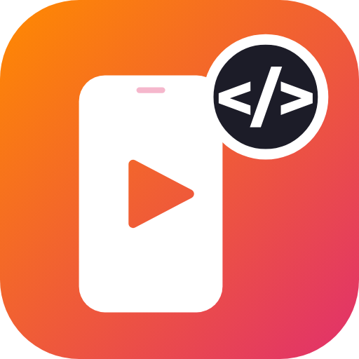

# reels-html

[Claude Code](https://claude.com/claude-code) plugin that produces **vertical 9:16 videos**
(Reels, Stories, TikTok, Shorts and ads) showing an app or system in use, from an HTML scene:
animated phone with taps, typing and screen transitions, captions synced with TTS narration,
a brand outro, and a sharp 1080×1920 MP4 ready to post.

Available in two languages — install only one.

| Language | Plugin | Install | Docs |
|---|---|---|---|
| English | `reels-html-en` | `/plugin install reels-html-en@reels-html` | [README](plugins/reels-html-en/README.md) |
| Português | `reels-html` | `/plugin install reels-html@reels-html` | [README](plugins/reels-html/README.md) |

First add the marketplace:

```
/plugin marketplace add brugodoi/reels-html
```

Requires Python 3.10+, Node 18+ and Google Chrome (or Edge, with `REELS_NAVEGADOR=msedge`).
On first use, the skill installs its Python and Node dependencies.


## Repository layout

```
plugins/reels-html/      Portuguese plugin (skill, engine, tools, template)
plugins/reels-html-en/   English plugin (same engine; translated docs, tools and template)
docs/                    icon and sample video
```

The engine (`skills/reels-html/motor/`) is shared: keep both copies identical when changing it.

## License

[MIT](LICENSE). The "Agendinha"/"Salonia" examples are fictional.
