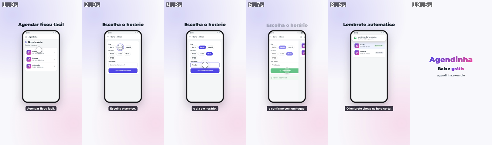

# reels-html

Skill do [Claude Code](https://claude.com/claude-code) que produz **vídeos
verticais 9:16** (Reels, Stories, TikTok, Shorts e anúncios) mostrando um app
ou sistema em uso, a partir de uma cena em HTML:

- celular animado com dedo, toques, digitação e troca de telas;
- título no topo e legenda da fala sincronizada com a locução;
- locução grátis (edge-tts) ou Google Cloud TTS;
- fecho com logo, chamada e site;
- gravação nítida quadro a quadro no Chrome e MP4 1080×1920 pronto pra postar.

*English: a Claude Code skill that turns an HTML scene (animated phone mockup
with taps, typing and screen transitions, synced captions and TTS voice-over)
into a 1080×1920 MP4 for Reels/TikTok/Shorts/ads. Docs in Portuguese.*



## Instalar

```bash
git clone https://github.com/brugodoi/reels-html ~/.claude/skills/reels-html
python -m pip install -r ~/.claude/skills/reels-html/requirements.txt
npm --prefix ~/.claude/skills/reels-html/ferramentas install
```

Precisa de Python 3.10+, Node 18+ e Google Chrome (ou Edge, com
`REELS_NAVEGADOR=msedge`). Pra usar só num projeto, clone em
`<projeto>/.claude/skills/reels-html`.

## Usar

No Claude Code, peça algo como *"faça um reel de 20 s mostrando como o
cliente agenda um horário no meu app"*. A skill guia o roteiro (você aprova),
monta a cena, gera a voz, sincroniza a legenda, grava, monta o MP4 e confere
os quadros antes de te entregar.

Na mão, de dentro da pasta do projeto de vídeo:

```bash
python ~/.claude/skills/reels-html/ferramentas/novo.py meu-video && cd meu-video
python ~/.claude/skills/reels-html/ferramentas/locucao.py demo     # audio/demo.wav
python ~/.claude/skills/reels-html/ferramentas/pausas.py demo      # sugere as legendas
node   ~/.claude/skills/reels-html/ferramentas/gravar.js demo      # quadros
python ~/.claude/skills/reels-html/ferramentas/montar.py demo      # mp4/demo.mp4
python ~/.claude/skills/reels-html/ferramentas/conferir.py demo 6  # mp4/demo-quadros.png
```

O passo a passo completo, a API do motor e os componentes estão no
[`SKILL.md`](SKILL.md).

## Estrutura

```
SKILL.md        instruções da skill (fluxo, motor, componentes, regras)
motor/          motor.js + base.css (palco, celular, componentes, dedo, legenda, fecho)
modelo/         projeto de exemplo copiado pelo novo.py (app fictício "Agendinha")
ferramentas/    novo · locucao · pausas · gravar · montar · conferir
```

## Licença

[MIT](LICENSE). O exemplo "Agendinha" é fictício.
